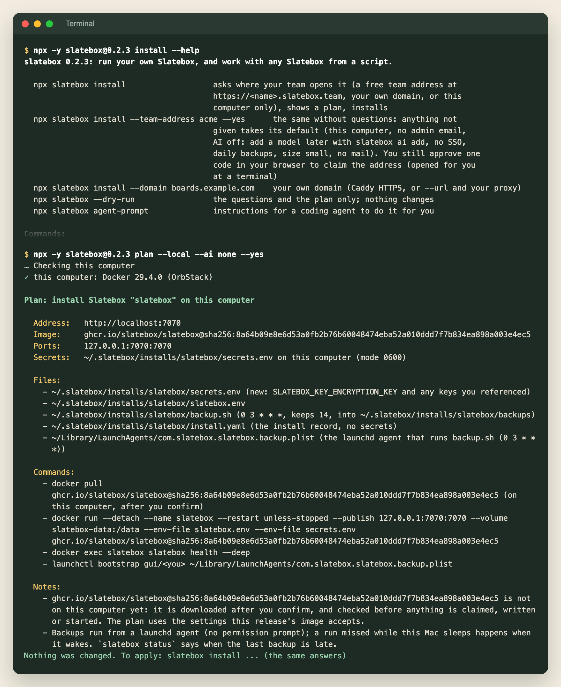
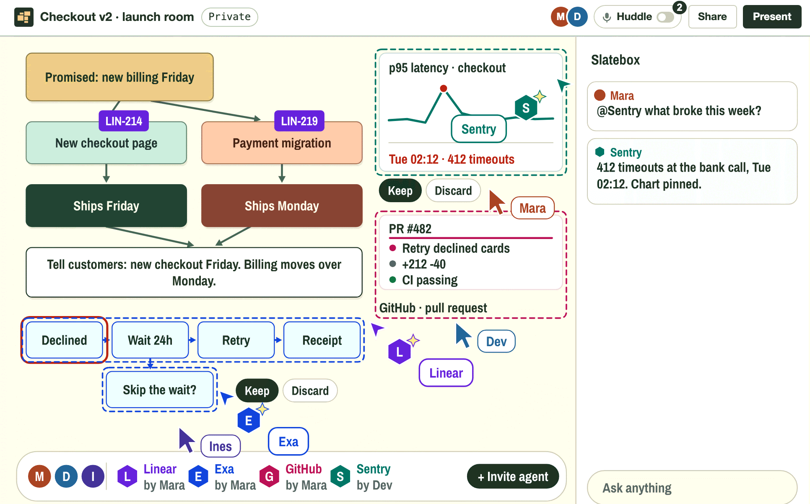
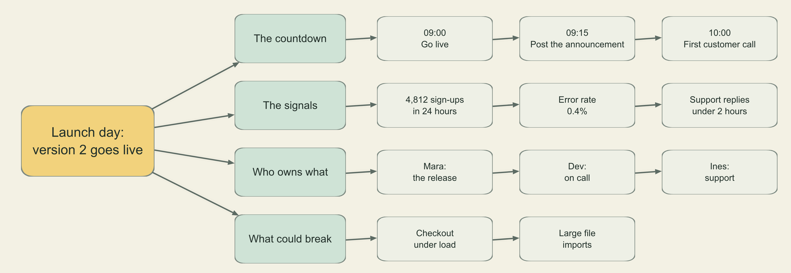
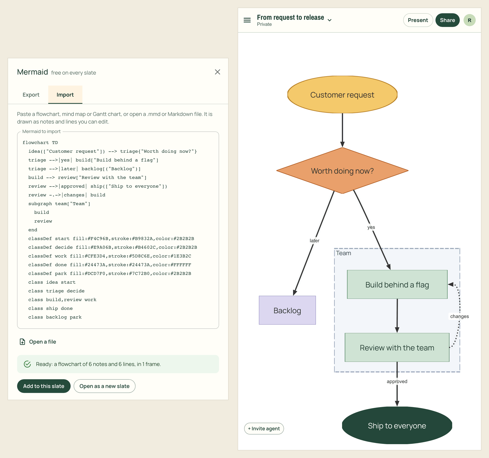
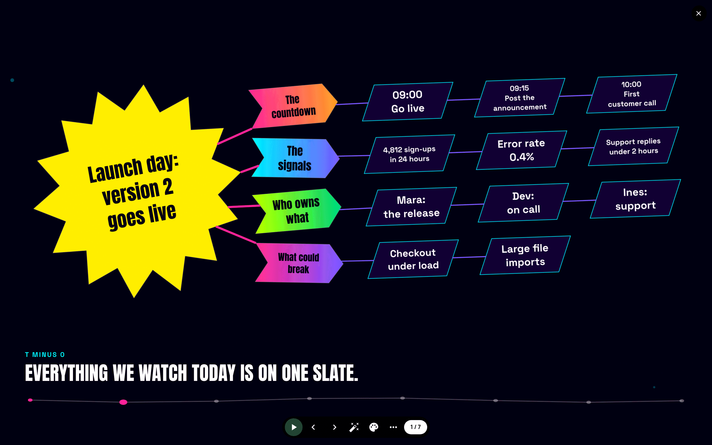
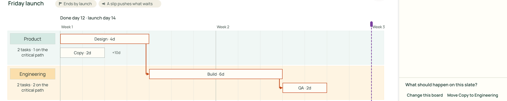
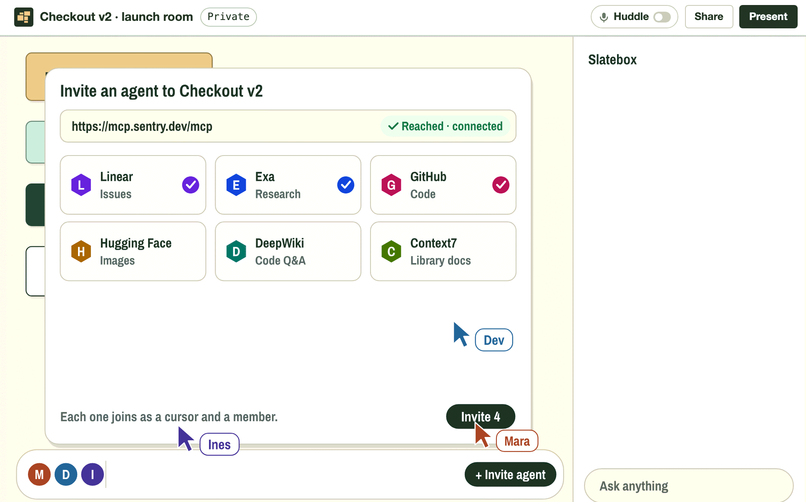

<p align="center">
  <a href="https://slatebox.com"></a>
</p>

<h1 align="center">Slatebox</h1>

<div align="center">

**Slatebox is the free, open-source visual intelligence platform for your team and agents.**<br>
People and agents on one live canvas: diagrams, mind maps, smart boards, plans and presentations. MIT licensed, except outside-agent connections in `enterprise/`. An open-source alternative to whiteboard tools such as Miro.

<sub>*Not affiliated with or endorsed by Miro. Miro is a trademark of its owner.*</sub>

</div>

<p align="center">
  <a href="LICENSE"></a>
  <a href="https://github.com/Slatebox/slatebox/releases"></a>
  <a href="https://www.npmjs.com/package/slatebox"></a>
  <a href="https://www.npmjs.com/package/slatebox-mcp"></a>
  <a href="https://registry.modelcontextprotocol.io/v0/servers?search=com.slatebox/slatebox"></a>
  <a href="https://github.com/Slatebox/slatebox/discussions"></a>
  <a href="https://github.com/Slatebox/slatebox/commits/main"></a>
</p>

<p align="center">
  <a href="https://slatebox.com">Website</a> ·
  <a href="https://docs.slatebox.com">Docs</a> ·
  <a href="https://app.slatebox.com">Cloud</a> ·
  <a href="https://support.slatebox.com">Support</a> ·
  <a href="CHANGELOG.md">Changelog</a>
</p>

## Run your own Slatebox in one command

```sh
npx slatebox install
```

- **It checks the machine first.** As soon as you pick where Slatebox runs, it checks what that needs (Docker running, the processor, disk space; SSH and Docker on a server; kubectl on a cluster) and names anything missing before it asks anything else.
- **One container, plain Docker.** The app, the live collaboration relay and MongoDB in one image, run with `docker run` (no Docker Compose). Keycloak for single sign-on is included and stays off until you turn it on.
- **Your address, your choice.** A free `https://<name>.slatebox.team` address (no DNS, ports or certificates), your own domain with automatic HTTPS, or this computer only. It can also install on a Linux server over SSH or on Kubernetes.
- **A plan before anything changes.** The installer shows everything it will write, run and create, and waits for your yes. `npx slatebox --dry-run` prints the plan and changes nothing. When it's done, it prints a one-time link to create the first admin.
- **Easy to look after.** Daily backups are on by default. Use `slatebox status`, `slatebox backup`, `slatebox upgrade` (backs up first, rolls back on failure) and `slatebox uninstall` (keeps your data unless you say otherwise). Bring any agent model you like, or none.

<p align="center">
  
  <br><sub>Real output of <code>slatebox@0.2.3</code>: the start of <code>install --help</code>, then <code>plan --local --ai none --yes</code>.</sub>
</p>

You need Docker (Docker Desktop, OrbStack, Colima, Docker Engine or Podman), plus Node.js 22.13 or newer for `npx`. Would you rather use Docker directly, or want the hardware notes? See the [self-hosting guide](self-host/README.md), the [installer's README](packages/slatebox/README.md) and the [operator docs](https://docs.slatebox.com/installation/install-with-docker/).

<p align="center">
  
  <br><sub>People and agents on one slate. This is a staged demo: the slatebox.com homepage replay running on the real SlateboxJS canvas, with scripted people and agents. It isn't an app screenshot.</sub>
</p>

## Other ways in

### Slatebox Cloud

Open [app.slatebox.com](https://app.slatebox.com) and start a slate, just for you or for your whole company. Guests don't need an account. The canvas is free. On Slatebox Cloud, AI comes with Slatebox Pro; a self-hosted Slatebox can use its own AI key. On Cloud, AI and calls you start can also be paid from a prepaid balance. Slatebox Pro and balances exist only on Slatebox Cloud. The details are on the [pricing page](https://slatebox.com/plans/).

### Connect your agent

Add **`https://app.slatebox.com/mcp`** as a remote MCP server (a custom connector) in Claude, ChatGPT, Cursor, VS Code or any MCP client. It signs you in to Slatebox and asks which permissions to give it. Then ask it for a mind map.

To run the MCP server on your own machine instead, create a token in **Profile → Developer access** and start it with npx:

```json
{
  "mcpServers": {
    "slatebox": {
      "command": "npx",
      "args": ["-y", "slatebox-mcp"],
      "env": { "SLATEBOX_API_TOKEN": "<your token>" }
    }
  }
}
```

To point it at your own Slatebox, add `"SLATEBOX_BASE_URL": "https://boards.example.com"`. A self-hosted Slatebox serves the same endpoint at `/mcp`. Read about [`exec`, the typed tools and the safety rules](packages/slatebox-mcp/README.md), or see the [agent setup guide](https://docs.slatebox.com/developers/slateboxapi/mcp/).

### Develop locally

The app is a [Meteor](https://www.meteor.com) 3 and React application in [`web/app`](web/app). It uses the SlateboxJS engine from a sibling checkout named `slateboxjs-v2`. The setup steps are in [web/README.md](web/README.md) and [CONTRIBUTING.md](CONTRIBUTING.md#development-setup).

## What you can do

<table>
  <tr>
    <td colspan="2">
      <strong>Mind maps, flowcharts and diagrams.</strong> Type steps with arrows and they're drawn as connected notes, no AI needed. Or describe what you want and Slatebox's agent drafts it as a preview you keep or discard.<br><br>
      
    </td>
  </tr>
  <tr>
    <td width="50%" valign="top">
      <strong>Mermaid in, Mermaid out.</strong> Paste a Mermaid flowchart, mind map or Gantt chart and get an editable slate. You can export any slate back as Mermaid.<br><br>
      
    </td>
    <td width="50%" valign="top">
      <strong>Presentations from any slate.</strong> Press Present and Slatebox plans the walkthrough: title cards, spotlights, reveals and camera moves across the canvas, in one of eight styles.<br><br>
      
    </td>
  </tr>
  <tr>
    <td colspan="2">
      <strong>Smart boards and Gantt plans.</strong> Launch plans, pipelines, budgets, hiring plans and retros, all made of notes. A move that breaks a board's rules is refused in words, for people and agents alike. To change a rule, just say so.<br><br>
      
    </td>
  </tr>
  <tr>
    <td width="50%" valign="top">
      <strong>People and agents, live.</strong> Share a link and people join with named cursors. Claude, ChatGPT, Cursor, a coding agent or your own script connects over MCP, the command line or the API and shows up as a named cursor too. An agent's edits are checked as if you had made them, and removing anything waits for a person's yes.
    </td>
    <td width="50%" valign="top">
      
      <br><sub>Inviting an outside MCP server (Sentry, Linear, Exa, GitHub and others) onto a slate. This is a staged demo from the homepage replay. This feature lives in <a href="enterprise/README.md"><code>enterprise/</code></a> (see <a href="#license">License</a>).</sub>
    </td>
  </tr>
</table>

You can also build smart components by chatting with Slatebox, or branch someone else's from the shared Library. Every submission is reviewed before it reaches the public library.

## The engine: SlateboxJS

The canvas is [SlateboxJS](https://github.com/Slatebox/slateboxjs), an MIT-licensed JavaScript library for mind maps, diagrams and concept drawing (`npm install slateboxjs`). To build it into your own app, see the [SlateboxJS docs](https://docs.slatebox.com/developers/javascriptlibrary/).

## What's in this repository

| Path | What it is |
| --- | --- |
| [`web/app`](web/app) | The Slatebox app behind Slatebox Cloud and every self-hosted install |
| [`self-host`](self-host) | The one-container image `ghcr.io/slatebox/slatebox` and its guide |
| [`packages/slatebox`](packages/slatebox) | `npx slatebox`: the installer and the `slatebox` command |
| [`packages/slatebox-mcp`](packages/slatebox-mcp) | The MCP server and CLI for agents (`slatebox-mcp`) |
| [`packages/create-slatebox`](packages/create-slatebox) | A thin `create-slatebox` wrapper around `npx slatebox install` (not published to npm yet) |
| [`enterprise`](enterprise) | Outside-agent connections and the Slatebox Cloud team-address service (not MIT, see [License](#license)) |
| [`docs`](docs) | Technical notes that live with the code ([docs.slatebox.com](https://docs.slatebox.com) is the published site) |
| [`scripts`](scripts) | Tests, checks and the release script |

## Releases and versioning

This repository ships three artifacts. Each one has its own version, tags and changelog, and all of them follow [Semantic Versioning](https://semver.org/spec/v2.0.0.html):

| Artifact | Published as | Tag | Changelog |
| --- | --- | --- | --- |
| The app and the self-host image | `ghcr.io/slatebox/slatebox:X.Y.Z` | `vX.Y.Z` | [CHANGELOG.md](CHANGELOG.md) |
| The installer and CLI | npm [`slatebox`](https://www.npmjs.com/package/slatebox) | `slatebox@X.Y.Z` | [packages/slatebox/CHANGELOG.md](packages/slatebox/CHANGELOG.md) |
| The MCP server | npm [`slatebox-mcp`](https://www.npmjs.com/package/slatebox-mcp) and the MCP Registry | `slatebox-mcp@X.Y.Z` | [packages/slatebox-mcp/CHANGELOG.md](packages/slatebox-mcp/CHANGELOG.md) |

Changelogs are generated from [Conventional Commits](https://www.conventionalcommits.org/en/v1.0.0/), and each tag becomes a [GitHub Release](https://github.com/Slatebox/slatebox/releases) with its changelog section as the notes. The details are in [docs/releasing.md](docs/releasing.md).

## Community

- **Questions and ideas:** [support.slatebox.com](https://support.slatebox.com), which runs on [GitHub Discussions](https://github.com/Slatebox/slatebox/discussions). [SUPPORT.md](SUPPORT.md) lists where to go for what.
- **Bugs:** [open an issue](https://github.com/Slatebox/slatebox/issues/new/choose).
- **Security problems:** please don't post them in public. [Report them privately](https://github.com/Slatebox/slatebox/security/advisories/new), as described in [SECURITY.md](SECURITY.md).
- **Contributing:** start with [CONTRIBUTING.md](CONTRIBUTING.md) and our [Code of Conduct](CODE_OF_CONDUCT.md). [GOVERNANCE.md](GOVERNANCE.md) explains who decides what and how changes land.

## License

Slatebox is [MIT licensed](LICENSE), and so is the [SlateboxJS](https://github.com/Slatebox/slateboxjs) engine. The one exception is the [`enterprise/`](enterprise/README.md) directory. It holds the connections to outside agents (inviting an outside MCP server onto a slate, and connectors) and the Slatebox Cloud team-address service behind `<name>.slatebox.team`. Everything in `enterprise/` is under the source-available [Slatebox Enterprise License](enterprise/LICENSE): you may read, change and test it, but running it in production needs an agreement with Slatebox LLC. Third-party components keep their own licenses. See [LICENSING.md](LICENSING.md).

Slatebox's own MCP server, command line and API, and single sign-on with the bundled Keycloak, are MIT and work on every install.

---

<p align="center">
  Free and collaborative since 2009. Open source since 2012.<br>
  Built by Slatebox LLC and Slatebox contributors.
</p>
